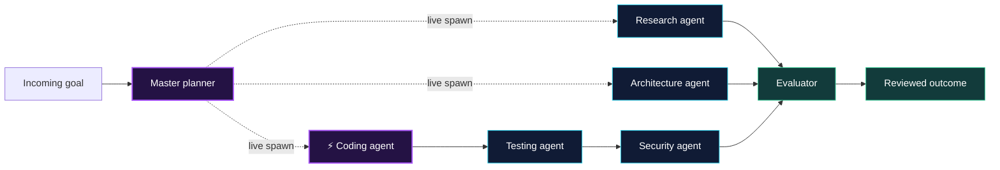

<div align="center">

# ◈ SEEKER LEGACY PROTOCOL

### REAL-TIME INTELLIGENCE. WEB3 EXECUTION. A NEW DIGITAL FRONTIER.

A futuristic Web3 operations platform where bounded AI agents assemble around the work—combining live agent orchestration, wallet-aware workflows, and subscription-powered access.

<br />

[](#technology)
[](#technology)
[](#web3-workflows)
[](#live-agent-orchestration)

</div>

---

<div align="center">

```text
          ╱╲             ┌──────────────────┐             ╱╲
         ╱ ◈ ╲            │   SEEKER CORE    │            ╱ ◈ ╲
        ╱─────╲           │  PLAN · SPAWN    │           ╱─────╲
       ╱  AI   ╲          │  BUILD · REVIEW  │          ╱  WEB3 ╲
      ╱  EMPIRE ╲         └────────┬─────────┘         ╱ FRONTIER╲
     ╱───────────╲            ┌─────┴─────┐            ╱──────────╲
    ◈ Specialist agents ◈  live coordination  ◈ wallet workflows ◈
```

**A goal enters. A specialist team takes shape. Work moves forward with structure and control.**

</div>

## ✦ The next dimension of Web3 operations

SEEKER brings a refined product experience and a coordinated AI worker system into one workspace. Instead of one all-powerful model, a master planner can spin up focused specialists for the task—making agent activity easier to follow, evaluate, and manage.

| ⚡ Live orchestration | 🛡️ Bounded by design | 🌌 Web3-native workflows |
|:--|:--|:--|
| Spawn focused coding and research agents as work is planned. | Constrained roles, execution limits, and review points for consequential actions. | Wallet-aware experiences, opportunity workflows, and subscription access in one product. |

## ⚡ Live agent orchestration

Watch a task fan out into purpose-built workers: a coding agent can be spawned alongside research, architecture, testing, and security specialists. Their outputs flow back through evaluation for a cohesive result.



**One planner. On-demand specialists. A coordinated result.** Agent depth, concurrency, and runtime are bounded, with approval points around actions that can have financial impact.

## 🌐 Web3 workflows

- Wallet connection and account-aware product experiences
- Airdrop opportunity discovery, ranking, and review queues
- Approval steps before consequential actions
- Operational dashboards and agent activity views
- Subscription plans that organize access to platform capabilities

## 💳 Subscription access for agents

Agent capabilities can be offered through subscription plans, with **Stripe-powered checkout and billing** supporting plan-based access and usage-aware entitlements. A product foundation designed to connect the value of specialist automation with clear subscription tiers.

## 🏗️ The system behind the experience

```text
┌─────────────────────────────────────┐
│        PRODUCT EXPERIENCE           │
│   React · Wallet · Dashboard · Plans│
└──────────────────┬──────────────────┘
                   │
┌──────────────────▼──────────────────┐
│          APPLICATION API            │
│    Express · tRPC · Drizzle · MySQL │
└──────────────────┬──────────────────┘
                   │
┌──────────────────▼──────────────────┐
│       AI EMPIRE WORKER               │
│ Cloudflare · Durable Objects         │
│ Plan → Spawn → Build → Evaluate      │
└─────────────────────────────────────┘
```

## 🧰 Technology

<div align="center">

| Product platform | AI Empire |
|:--|:--|
| TypeScript · React 19 · Vite · Tailwind | TypeScript · Cloudflare Workers |
| Express · tRPC · Drizzle ORM · MySQL | Durable Objects · Wrangler · Vitest |
| Stripe · Solana wallet ecosystem · AI integrations | Event-driven, bounded orchestration |

</div>

## 🚀 Expanding the frontier

Richer wallet and on-chain intelligence · Smarter opportunity discovery · More specialist roles for operations and compliance · Configurable AI Empire foundations beyond Web3

---

<div align="center">

### INTELLIGENCE WITH STRUCTURE. AUTOMATION WITH BOUNDARIES.

**SEEKER LEGACY PROTOCOL**  ·  *Built for the next generation of Web3 operations.*

</div>
