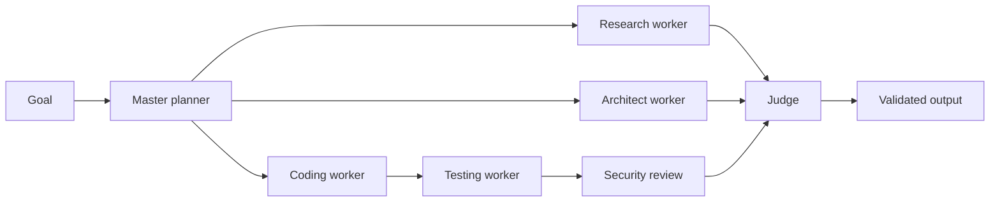

<div align="center">

# ◈ AI EMPIRE WORKER

### LIVE AGENT SPAWNING. BOUNDED ORCHESTRATION. FUTURISTIC EXECUTION.

A high-velocity AI coordination layer that assembles specialist workers around a goal, tracks memory, evaluates outcomes, and repairs failures without losing operational control.

<br />

[](#deployment)
[](#architecture)
[](#runtime)
[](#principles)

</div>

---

<div align="center">

```text
      ┌──────────────────────────────────────┐
      │    PLAN → SPAWN → EXECUTE → REVIEW    │
      │  master agent creates specialists     │
      │  research • code • test • security     │
      └──────────────────────────────────────┘
```

**The Empire does not run wild. It assembles a team, sets limits, and validates every outcome.**

</div>

## ⚡ What the worker does

AI Empire is the runtime layer behind the SEEKER platform: a bounded autonomous system that creates specialist agents, persists context, and learns from failure. Instead of a single ungoverned model, the system coordinates a small, disciplined team around a single objective.

| 🧠 Planner | 🔍 Research | ⚙️ Build | ✅ Evaluate |
|:--|:--|:--|:--|
| Breaks goals into clearly defined work. | Gathers context and constraints. | Produces code or solution artifacts. | Tests, reviews, and decides if the work is valid. |

## 👥 Live specialist spawning

A task enters the system and the master planner decides which capabilities are missing. It then spins up purpose-driven workers for research, coding, testing, security review, and evaluation.



This creates a real operational rhythm: the system does not “think in the abstract,” it produces work in structured layers, remembers what happened, and can repair failed attempts with an explicit learning loop.

## 🛡️ Bounded execution model

The system is intentionally designed to avoid open-ended autonomy.

- role-specific worker creation with a defined objective
- caps on depth, concurrency, and runtime
- explicit failure capture and lesson retention
- repair workers triggered by failures instead of blind retry loops
- security-aware evaluation and gated review before acceptance

## 🔄 Failure-to-learning loop

The Empire is built to improve through disciplined feedback. When a worker fails, the failure is recorded and translated into a lesson. That lesson is then used to spawn a repair worker, which helps close the gap without starting from zero.

## 🧪 Local demo

From the repository root:

```bash
pnpm --dir ai-empire install --no-frozen-lockfile
pnpm --dir ai-empire test
pnpm --dir ai-empire demo
```

The demo creates the master, research, code, and judge workers; triggers a real assertion failure; records the lesson; then deploys a repair worker to validate the fix.

## ☁️ Cloudflare deployment

Install Wrangler and authenticate via Cloudflare:

```bash
pnpm --dir ai-empire install --no-frozen-lockfile
pnpm --dir ai-empire exec wrangler login
pnpm --dir ai-empire exec wrangler secret put LLM_API_URL
pnpm --dir ai-empire exec wrangler secret put LLM_API_KEY
pnpm --dir ai-empire exec wrangler secret put LLM_MODEL
pnpm --dir ai-empire deploy
```

The cron trigger is configured for a regular execution cycle, consistent with bounded, event-driven orchestration rather than 24/7 unverified autonomy.

## 🔌 API surface

- `GET /health` — health and execution mode check
- `GET /dashboard` — minimal live state dashboard
- `GET /api/state` — current Durable Object state
- `POST /api/run` with `{ "goal": "...", "demoFailure": true }` — run a bounded cycle
- `POST /api/llm-check` — provider check, only when secrets are configured

## 🧩 Architecture

```text
┌──────────────────────────────────────────────┐
│        Event source / trigger               │
│     goal, schedule, user interaction        │
└────────────────────┬─────────────────────────┘
                     │
                     ▼
┌──────────────────────────────────────────────┐
│         AI Empire Worker runtime             │
│    planner → spawn → evaluate → repair      │
│     Cloudflare Worker + Durable Object       │
└────────────────────┬─────────────────────────┘
                     │
                     ▼
┌──────────────────────────────────────────────┐
│      Specialist worker network               │
│ researcher • architect • coder • tester     │
│ security • judge • repair                   │
└──────────────────────────────────────────────┘
```

---

<div align="center">

### STRUCTURED AUTONOMY. CONTROLLED INTELLIGENCE.

**AI Empire** · *The operating core of the SEEKER protocol.*

</div>

