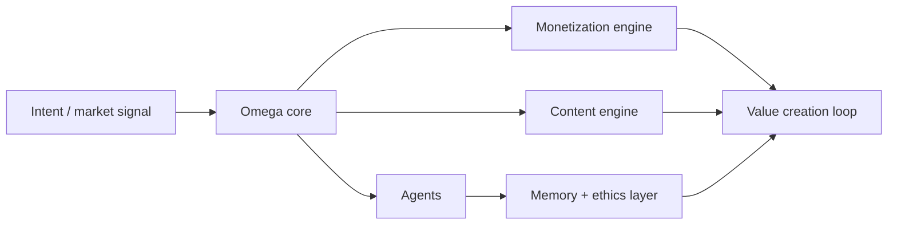

<div align="center">

# ◈ SEEKER OMEGA

### SEEKERMONEYGENE

### A FUTURISTIC CAPITAL ENGINE FOR ETHICAL, COMPOUNDING INTELLIGENCE.

Bounded AI systems for systematic strategy, value creation, and transparent digital growth—without hype-driven fake revenue claims or spammy automation.

<br />

[](#stack)
[](#principles)
[](#architecture)
[](#ecosystem)

</div>

---

<div align="center">

```text
      ┌──────────────────────────────┐
      │  OMEGA CORE                  │
      │  intelligence • strategy    │
      │  memory • ethics • growth    │
      └──────────────┬───────────────┘
                     │
         ┌───────────▼────────────┐
         │   AGENTS + ENGINES      │
         │ monetization • content  │
         │ orchestration • value   │
         └─────────────────────────┘
```

**Purposeful execution. Transparent systems. Compounding value with guardrails.**

</div>

## ✦ The mission

SEEKER OMEGA is a bounded AI civilization engine built for value-first growth. It focuses on sustainable automation, curated intelligence, and responsible monetization systems that are designed to stay clear, explainable, and operationally disciplined.

## 🧠 Core principles

- AI systems should support real value creation, not noise
- automation must remain bounded and explainable
- money systems should be transparent and accountable
- growth is strongest when it compounds with ethics and trust

## ⚙️ System layout

```text
src/
├── index.ts
├── types.ts
├── core/
│   ├── omega
│   ├── agents
│   ├── memory
│   └── ethics
├── engines/
│   ├── content
│   ├── monetization
│   └── orchestration
├── docs/
│   ├── ARCHITECTURE
│   └── ETHICS
└── README.md
```

## 🌌 Why it matters

Most automated systems optimize for speed, noise, or artificial momentum. SEEKER OMEGA is designed for a different operating model:

- tightly scoped agents with explicit purpose
- valuable content and monetization flows
- memory that supports better decisions over time
- transparent strategy and ethical review loops

## 🧩 Architecture overview



## 🧪 Quick start

```bash
pnpm install && pnpm dev
pnpm test && pnpm typecheck
```

## 🧰 Stack

- TypeScript
- Event-driven orchestration patterns
- AI agents with bounded execution logic
- Memory and ethics-aware system design
- Value generation and monetization modules

## 🔗 Companion project

This module is part of the broader SEEKER ecosystem:

- https://github.com/Hackathon-SobbOma/seeker-legacy-protocol-ai-empire

---

<div align="center">

### VALUE-FIRST INTELLIGENCE. TRANSPARENT GROWTH. ETHICAL AUTONOMY.

**SEEKER OMEGA** · *Compounding systems for the next generation of digital operations.*

</div>

